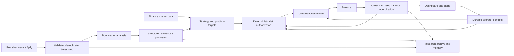

# Trading-agent architecture research

Reviewed 8 November 2026. Scope: a Binance spot bot, initially €300 of paper capital, with a separate $10,000 development and operating budget. “Etf” was clarified as “etcetera.”

## Recommendation

**Evaluate Freqtrade as an execution-platform candidate before expanding our custom exchange code. Keep our frontend, news ingestion, research records, and conservative order-submission guarantees. Add AI as a bounded analysis service.**

Freqtrade is the closest functional fit for our slower candle strategies. Hummingbot supplies particularly useful executor, fill, fee, and reconciliation patterns. NautilusTrader is the strongest alternative to investigate if we need a broader event-driven trading kernel. LEAN is relevant if the product grows into a multi-asset portfolio platform. These are engineering judgments from source inspection, not measured rankings or migration decisions.

The AI frameworks are useful references for research workflows, memory and tool boundaries. They do not establish profitable trading. Condor is a concrete example of an LLM connected to an execution platform, with important permission and configuration qualifications.

## Method and limits

Inspected official public repositories, documentation, implementation files, tests and licenses at the commits linked below. No upstream code was executed, engines installed, models called, paid data purchased, exchange orders submitted, or deployments changed. This is a review of selected open-source architectures, not an audit of private trading firms or a profitability benchmark. Default-branch snapshots include development/release-candidate code; adoption should use a separately selected and tested release.

## Existing systems and their fit

| System | Observed architecture | Fit for this project | Verified core license |
| --- | --- | --- | --- |
| [Freqtrade][ft-loop] | Strategy/candle loop → wallet and position checks → CCXT exchange adapter; persisted orders/trades, dry run, research tooling and management API. | First candidate for a controlled comparison with our slow Binance spot strategy. | [GPL-3.0-only][ft-license] |
| [Hummingbot][hb-controller] | Controllers produce typed actions; executors manage position/order lifecycles; connectors handle venue events, fills and recovery. | Useful execution/accounting reference; a broader platform to consider for market-making or multiple venues. | [Apache-2.0][hb-license] |
| [NautilusTrader][nt-architecture] | Shared data/risk/execution/portfolio components, message bus, Rust engine and Python interfaces; adapters for backtest, sandbox and live. | Strong architecture reference and alternative integration candidate; current inspected release transition adds runtime work. | [LGPL-3.0-only][nt-metadata] |
| [QuantConnect LEAN][lean-framework] | Alpha insights → portfolio targets → risk-adjusted targets → execution; brokerage abstraction and accounting models. | Most relevant if we expand into a broader portfolio/research product; adds .NET and ecosystem complexity. | [Apache-2.0][lean-license] |
| [TradingAgents][ta-graph] | LangGraph analysts → bull/bear debate → trader proposal → risk discussion → final recommendation. | Research/recommendation workflow; the inspected core is not our Binance execution service. | [Apache-2.0][ta-license] |
| [FinRobot V2][fr-lead] | PydanticAI lead agent, five role agents, typed research pipelines, deterministic financial computation and persisted reports. | Useful provenance, structured-output and research-memory patterns; equity research is its main reviewed scope. | [Apache-2.0][fr-license] |
| [Hummingbot Condor][co-runtime] | Scheduled/chat LLM reasoning → permissioned MCP tools → authenticated Hummingbot API → executors/bots. | Closest inspected example of an AI harness controlling an existing trading platform; requires careful tool and risk configuration. | [MIT][co-license] |

Licenses describe the inspected projects. Data feeds, hosted services, plugins and dependencies can have separate terms and charges.

## Findings that affect our decisions

### 1. Execution deserves a dedicated state machine

Hummingbot separates a controller's desired action from the executor that owns the order lifecycle. Its Binance connector obtains order status, individual fills and balances separately. Fill updates are deduplicated by trade ID and retain commission amount and asset. Its recorder persists fills and connector tracking state. These are useful models for our missing ledger. Its lost-order and fill-wait policies still require testing; their existence is not a proof of complete reconciliation. [Connector][hb-binance], [fill deduplication][hb-fills], [recorder][hb-recorder].

LEAN similarly separates portfolio targets from order execution. Its brokerage interface supplies order operations, open orders, cash and holdings; setup imports broker state. We should borrow those contracts even if we do not use LEAN. Its current Binance integration is a separate official plugin, whose documented CLI workflow mentions a module subscription. Open-source core licensing alone does not establish the cost of a particular deployment path. [Framework][lean-framework], [brokerage interface][lean-interface], [Binance plugin][lean-binance].

### 2. Persistence must be assessed at the network boundary

Our SQLite intent and submission claim commit before broker I/O. Preserve this property during any integration.

NautilusTrader explicitly documents a persistence gap: its built-in cache/backend and event-store writes are asynchronous and do not gate transport on durable commit. Venue acceptance can precede durable local history. Its reconciliation facilities are valuable, but they are not a universal exactly-once guarantee. [Documented policy][nt-policy].

The inspected Freqtrade entry path calls the exchange before committing the corresponding Trade/Order model. This review did not establish how every accepted-but-unrecorded crash case is recovered. That boundary is an acceptance test for adoption, rather than a reason to assume either correctness or failure. [Entry path][ft-entry], [later commit][ft-commit].

Binance itself says an API timeout can leave execution status unknown. Its client order IDs are unique among open orders and can be accepted again after a previous order fills. A stable ID alone is insufficient protection against an accidental second trade. [Timeout semantics][bn-timeout], [client-ID semantics][bn-client-id].

### 3. “Risk management” has different meanings

Freqtrade has stop-loss handling and entry protections. Its inspected Binance spot capability is stop-loss-limit; its MaxDrawdown protection evaluates closed trades. Neither implies a guaranteed marked-to-market portfolio loss cap. [Binance capabilities][ft-binance], [drawdown implementation][ft-drawdown].

Nautilus has an explicit [RiskEngine][nt-risk], order validation/throttling and trading states. LEAN has framework risk models that adjust targets. TradingAgents' risk personas provide model deliberation; the reviewed workflow ends with a recommendation. These mechanisms perform different jobs. For our system, hard limits must be implemented in code at the order authorization boundary.

Condor has real typed-tool checks and different attended, unattended, dry-run and shutdown policies. However, some drawdown/leverage/drift defaults are disabled, and unknown risk keys are reported as unenforced. Its optional `run_code` capability explicitly executes unsandboxed Python with process/API access. That capability requires admin or an explicit grant; it is not default access for every user. We did not reproduce an exploit or conduct a security audit. The practical lesson is to keep our model's tools narrow and verify actual configured enforcement. [Risk defaults][co-risk], [code contract][co-code], [permission check][co-permission].

### 4. Research backtests need their scope checked

TradingAgents' README mentions a simulated exchange, but the inspected backtest and tests explicitly describe recommendation evaluation without portfolio execution, fees or an equity curve. Its output can be useful research; it cannot establish the net return of an automated Binance account. [Backtest implementation][ta-backtest], [scope tests][ta-tests].

FinRobot V2's ordinary chat backtest calls a Backtrader adapter with an explicit zero-commission/zero-slippage warning. A separate strategy-selection helper has bounded tuning and chronological holdout logic; short windows can fall back to an explicitly warned in-sample result. The ordinary chat path does not automatically inherit that holdout workflow. [Chat tool][fr-backtest-tool], [adapter][fr-backtest], [selection helper][fr-selection].

Our evaluation must measure account-level returns after fees, spread/slippage, failed/partial fills, and recurring model/data costs. Preserve chronological holdouts, point-in-time news and a frozen forward paper policy. Today's LLM may know historical events; retrospective model answers can contain information unavailable at the claimed trading time. Weeks of paper operation establish operational evidence, while statistical confidence also depends on the number of trades and market regimes.

### 5. Memory has separate responsibilities

The inspected TradingAgents memory stores decisions, later outcomes and generated reflections, with point-in-time filtering and optional workflow checkpoints. FinRobot persists research artifacts, provenance, runs and transcripts. Condor uses curated file memory, journals and scratch state; its scratch state is expressly not a capital ledger. [TradingAgents memory][ta-memory], [FinRobot provenance][fr-provenance], [Condor memory][co-memory], [scratch-state contract][co-state].

For our bot:

- **Financial records:** exact orders, fills, commissions, reservations, balances and reconciliation evidence, owned by the execution/accounting service.
- **Research records:** immutable market/news inputs, publication and first-observed times, model/prompt versions, tool responses and proposed decisions.
- **Research notes:** retrieved summaries, hypotheses and reflections linked to those records. Generated notes do not change risk limits or verified financial facts.

SQLite remains a reasonable initial store for our single worker. A vector database is optional for later document retrieval; it is not required to establish these responsibilities.

## Proposed architecture for our product

This is a proposed design based on the review, not a claim that every component is implemented.

The execution owner alone holds exchange trading credentials. The analysis service receives read-only snapshots and emits a validated proposal with instrument, evidence IDs, observation times, horizon/expiry and a no-decision outcome. Position sizing and hard limits remain deterministic. For a first AI experiment, start with event classification and an entry-risk flag; grant broader influence only if prospective paper comparisons justify it.

Apify belongs in the ingestion layer. It can collect otherwise inconvenient publisher data, while the exchange remains the source of prices and account events. Begin with a small set of identifiable sources, bounded response sizes, immutable first-observed timestamps and deduplication. No paid actor, actor price or signal quality was verified by this review. A leaderboard ranking alone does not validate a copy-trading policy; that requires timestamped histories and forward evidence after costs.

Run analysis on new relevant evidence or a closed decision candle, with caching and a hard inference budget. At four-hour decisions there are six scheduled decisions per day per pair; tool loops, debates and retries can multiply model calls. Pause and closing must continue to work when a model/news provider is unavailable. Host services on a persistent server with a private execution API, tested backups and independent alerts. One trading worker is enough for this initial scope.

## Binance accounting requirements verified directly

Official `executionReport` events distinguish last and cumulative filled quantity, last price, order ID, trade ID, commission and commission asset. Account events distinguish free and locked balances. `GET /api/v3/myTrades` provides trade history with fees, but recovery requires pagination/checkpoints: the documented maximum page is 1,000 trades. [Events][bn-events], [trade history][bn-trades].

Reconcile open orders, individual fills, fees and account movements at startup and periodically. Deduplicate by venue/account/symbol/trade identity. Preserve fees in their actual asset, including a third asset such as BNB. An unexplained balance difference must block new exposure and produce an alert instead of being silently overwritten.

Live symbol filters and account fee schedules must be fetched/validated. Our fixed simulated rules and flat quote-asset fee are fixtures. Market WebSockets require reconnect handling; documented market-stream connections expire after 24 hours. Spot Testnet has virtual funds and periodic resets, which require environment-specific recovery treatment and do not validate real liquidity or profitability. [Filters][bn-filters], [market streams][bn-streams], [Testnet][bn-testnet].

## Integration plan and decision gates

1. **Run an isolated, pinned Freqtrade dry-run comparison.** One pair, one frozen candle strategy, realistic €300 virtual capital and explicit costs. Translate the strategy and check signal parity; keep our working app intact. Confirm current account/region/pair support and API behavior.
2. **Exercise failures before choosing the backend.** Test accepted order with lost response, crash after acceptance, restart, duplicated/out-of-order fills, partial-fill/cancel races, fee assets, manual account changes, stale data, and pause/flatten during slow requests. Use simulated injection and exchange Testnet for their respective purposes.
3. **Compare total integration cost.** Assess accounting completeness, failure recovery, control semantics, API fit, maintenance and deployment. Adopt Freqtrade only if the evidence supports it. If it cannot preserve the required boundary, evaluate Nautilus or retain our core and implement the inspected ledger/reconciliation contracts.
4. **Integrate the selected engine through an adapter.** Keep one owner of orders/account state. Our dashboard should use its authenticated query/command interface rather than independently modifying its database or also submitting exchange orders. A news/model process supplies cached features; it does not bypass the engine through an unrestricted force-trade API.
5. **Prove operations, then evaluate AI.** Test backup restoration, readiness alerts and Fly restart/outage behavior. Run a frozen price-only baseline and the same policy with news/AI under identical accounting. Report gross trading results and recurring operating costs separately, plus net economics.

For a $10,000 development/operations budget, integration, reconciliation, data quality and recovery testing deserve explicit milestones. Vendor/model prices and delivery quotes were not established here. The €300 trading allocation is separate: as arithmetic only, €10/month of recurring expense equals 3.33% of that capital per month before exchange friction. This is a cost hurdle, not a return forecast.

## Current code versus the proposed architecture

Our simulation already has persistent control intent, a conservative uncertain-submission journal, basic hard order checks, news observation timestamps, authentication and a clean frontend. The most important remaining gaps are a complete fill/commission/account ledger, actual venue reconciliation, tested backups/alerts, and verified deployment. Automatic real-money execution and OpenAI analysis are not connected. See [the infrastructure review](INFRASTRUCTURE_REVIEW.md).

**The immediate research-led change is to evaluate an existing engine before committing the remaining budget to custom execution plumbing.** No migration was performed. An adoption decision should depend on the comparison evidence; no framework here establishes a profitable strategy.

## Pinned source references

The full commit is embedded in every source link. Nautilus master and develop were both inspected; their versions are release candidates, and the master package requires Python 3.13–3.14 while our prepared environment uses 3.12. The current [LEAN README][lean-readme] specifies .NET 10. These are integration constraints, not claims about the latest available package on an external registry.

[ft-loop]: https://github.com/freqtrade/freqtrade/blob/58d4e710f9bb0fdb25116e4c64261909dc2f6762/freqtrade/freqtradebot.py#L307-L365
[ft-license]: https://github.com/freqtrade/freqtrade/blob/58d4e710f9bb0fdb25116e4c64261909dc2f6762/pyproject.toml#L15-L17
[ft-entry]: https://github.com/freqtrade/freqtrade/blob/58d4e710f9bb0fdb25116e4c64261909dc2f6762/freqtrade/freqtradebot.py#L1134-L1150
[ft-commit]: https://github.com/freqtrade/freqtrade/blob/58d4e710f9bb0fdb25116e4c64261909dc2f6762/freqtrade/freqtradebot.py#L1236-L1243
[ft-binance]: https://github.com/freqtrade/freqtrade/blob/58d4e710f9bb0fdb25116e4c64261909dc2f6762/freqtrade/exchange/binance.py#L29-L62
[ft-drawdown]: https://github.com/freqtrade/freqtrade/blob/58d4e710f9bb0fdb25116e4c64261909dc2f6762/freqtrade/plugins/protections/max_drawdown_protection.py#L44-L112
[hb-controller]: https://github.com/hummingbot/hummingbot/blob/9af100d6822da7d2d0291a906c730ef172284ee2/hummingbot/strategy_v2/controllers/controller_base.py#L268-L279
[hb-license]: https://github.com/hummingbot/hummingbot/blob/9af100d6822da7d2d0291a906c730ef172284ee2/LICENSE
[hb-binance]: https://github.com/hummingbot/hummingbot/blob/9af100d6822da7d2d0291a906c730ef172284ee2/hummingbot/connector/exchange/binance/binance_exchange.py#L350-L535
[hb-fills]: https://github.com/hummingbot/hummingbot/blob/9af100d6822da7d2d0291a906c730ef172284ee2/hummingbot/core/data_type/in_flight_order.py#L351-L371
[hb-recorder]: https://github.com/hummingbot/hummingbot/blob/9af100d6822da7d2d0291a906c730ef172284ee2/hummingbot/connector/markets_recorder.py#L330-L460
[nt-architecture]: https://github.com/nautechsystems/nautilus_trader/blob/5c392e8cb056668274a797833b5ee9266707a63f/docs/concepts/architecture.md
[nt-metadata]: https://github.com/nautechsystems/nautilus_trader/blob/42712f8d67a5335bc05727f66f96f2f98114e99a/python/pyproject.toml
[nt-policy]: https://github.com/nautechsystems/nautilus_trader/blob/42712f8d67a5335bc05727f66f96f2f98114e99a/docs/concepts/execution/policies.md#persistence-before-transport
[nt-risk]: https://github.com/nautechsystems/nautilus_trader/blob/5c392e8cb056668274a797833b5ee9266707a63f/crates/risk/src/engine/mod.rs
[lean-framework]: https://github.com/QuantConnect/Lean/blob/cc98c42f5543256cea0a33e4521401e42303b7d7/Algorithm/QCAlgorithm.Framework.cs#L153-L243
[lean-license]: https://github.com/QuantConnect/Lean/blob/cc98c42f5543256cea0a33e4521401e42303b7d7/LICENSE
[lean-interface]: https://github.com/QuantConnect/Lean/blob/cc98c42f5543256cea0a33e4521401e42303b7d7/Common/Interfaces/IBrokerage.cs
[lean-binance]: https://github.com/QuantConnect/Lean.Brokerages.Binance/blob/7c7b15c6be8e4fee337ec7d06f90a43d0fd64f6c/README.md
[lean-readme]: https://github.com/QuantConnect/Lean/blob/cc98c42f5543256cea0a33e4521401e42303b7d7/readme.md
[ta-graph]: https://github.com/TauricResearch/TradingAgents/blob/9fa1196fffbcfd9de5146d2dd2869df84ab99838/tradingagents/graph/setup.py
[ta-license]: https://github.com/TauricResearch/TradingAgents/blob/9fa1196fffbcfd9de5146d2dd2869df84ab99838/LICENSE
[ta-backtest]: https://github.com/TauricResearch/TradingAgents/blob/9fa1196fffbcfd9de5146d2dd2869df84ab99838/tradingagents/backtest.py#L1
[ta-tests]: https://github.com/TauricResearch/TradingAgents/blob/9fa1196fffbcfd9de5146d2dd2869df84ab99838/tests/test_backtest.py#L1
[ta-memory]: https://github.com/TauricResearch/TradingAgents/blob/9fa1196fffbcfd9de5146d2dd2869df84ab99838/tradingagents/memory/log.py
[fr-lead]: https://github.com/AI4Finance-Foundation/FinRobot/blob/63e1884a42ea7b729551a5424b4bd6a65af636e0/finrobot_desktop/finrobot/engine/orchestrator.py#L195
[fr-license]: https://github.com/AI4Finance-Foundation/FinRobot/blob/63e1884a42ea7b729551a5424b4bd6a65af636e0/finrobot_desktop/LICENSE
[fr-backtest-tool]: https://github.com/AI4Finance-Foundation/FinRobot/blob/63e1884a42ea7b729551a5424b4bd6a65af636e0/finrobot_desktop/finrobot/engine/orchestrator.py#L440
[fr-backtest]: https://github.com/AI4Finance-Foundation/FinRobot/blob/63e1884a42ea7b729551a5424b4bd6a65af636e0/finrobot_desktop/finrobot/engine/backtest/backtrader_adapter.py#L133
[fr-selection]: https://github.com/AI4Finance-Foundation/FinRobot/blob/63e1884a42ea7b729551a5424b4bd6a65af636e0/finrobot_desktop/finrobot/engine/backtest/strategy_agent.py#L171
[fr-provenance]: https://github.com/AI4Finance-Foundation/FinRobot/blob/63e1884a42ea7b729551a5424b4bd6a65af636e0/finrobot_desktop/finrobot/engine/data/normalize/contracts.py#L169
[co-runtime]: https://github.com/hummingbot/condor/blob/a817f6633a90afe41523377bfd360c0b9316d423/condor/runtime/llm_client.py#L32-L109
[co-license]: https://github.com/hummingbot/condor/blob/a817f6633a90afe41523377bfd360c0b9316d423/LICENSE
[co-risk]: https://github.com/hummingbot/condor/blob/a817f6633a90afe41523377bfd360c0b9316d423/condor/agents/risk.py#L63-L125
[co-code]: https://github.com/hummingbot/condor/blob/a817f6633a90afe41523377bfd360c0b9316d423/condor/code_runner.py#L1-L35
[co-permission]: https://github.com/hummingbot/condor/blob/a817f6633a90afe41523377bfd360c0b9316d423/condor/web/routes/code.py#L43-L85
[co-memory]: https://github.com/hummingbot/condor/blob/a817f6633a90afe41523377bfd360c0b9316d423/condor/memory/store.py#L1-L240
[co-state]: https://github.com/hummingbot/condor/blob/a817f6633a90afe41523377bfd360c0b9316d423/condor/runtime/state.py#L1-L59
[bn-timeout]: https://github.com/binance/binance-spot-api-docs/blob/2bae3f5bd622ebfdea593daed066df14dc7e7362/rest-api.md#L115-L122
[bn-client-id]: https://github.com/binance/binance-spot-api-docs/blob/2bae3f5bd622ebfdea593daed066df14dc7e7362/rest-api.md#L2160
[bn-events]: https://github.com/binance/binance-spot-api-docs/blob/2bae3f5bd622ebfdea593daed066df14dc7e7362/user-data-stream.md#L32-L130
[bn-trades]: https://github.com/binance/binance-spot-api-docs/blob/2bae3f5bd622ebfdea593daed066df14dc7e7362/rest-api.md#L4726-L4786
[bn-filters]: https://github.com/binance/binance-spot-api-docs/blob/2bae3f5bd622ebfdea593daed066df14dc7e7362/filters.md
[bn-streams]: https://github.com/binance/binance-spot-api-docs/blob/2bae3f5bd622ebfdea593daed066df14dc7e7362/web-socket-streams.md#L49-L61
[bn-testnet]: https://github.com/binance/binance-spot-api-docs/blob/2bae3f5bd622ebfdea593daed066df14dc7e7362/testnet/general-info.md#L92-L125
