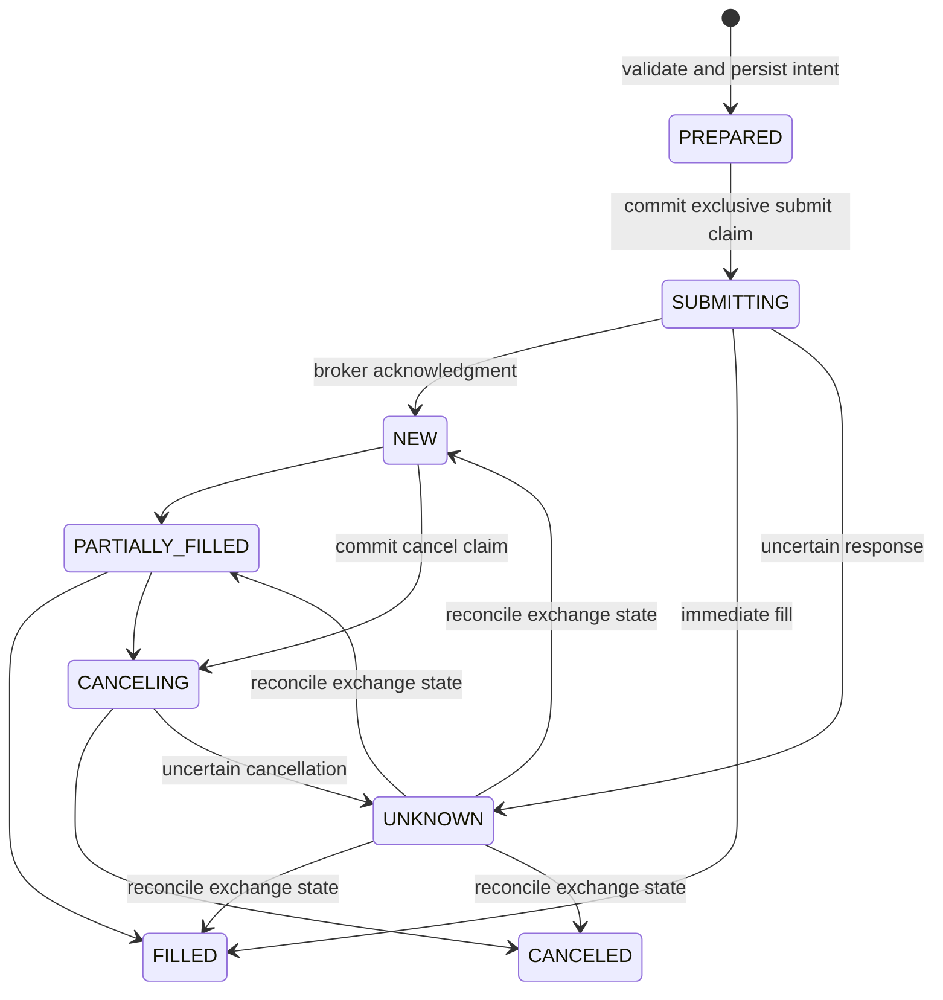

# Durable execution milestone

This adds a manually driven order service with a persistent intent journal,
exact-decimal risk checks, an offline simulator, and a **Binance Spot Testnet**
adapter. Simulation is the default. There is no production Binance order
endpoint or automatic connection from a trading strategy to this service.

The $10,000 discussed for this project is development/operating budget. The
default execution cap remains **300 quote-currency units per order**, excluding
fees. It is neither a capital allocation nor a $10,000 trading limit.

## Try the offline order lifecycle

From the existing checkout:

```bash
cd /workspace/tradingbot
python3 -m tradingbot execution --db data/execution_demo.sqlite3 --account milestone-demo \
  prepare --request first-buy --symbol BTC/EUR --side BUY \
  --quantity 0.001 --limit-price 60000
python3 -m tradingbot execution --db data/execution_demo.sqlite3 --account milestone-demo \
  submit --request first-buy
python3 -m tradingbot execution --db data/execution_demo.sqlite3 --account milestone-demo balances
python3 -m tradingbot execution --db data/execution_demo.sqlite3 --account milestone-demo \
  list --request first-buy
```

The demonstration uses an **illustrative price**, not a live quote. An ignored
local demonstration database has already been created by these commands. It
starts with fake EUR 300, fills BTC 0.001 at EUR 60,000, charges a simulated
EUR 0.06 fee, and ends with EUR 239.94 and BTC 0.001. Repeating these commands
uses the existing request and does not buy again. Use another database/account
for a separate experiment; existing funds are never reset.

The simulator fills immediately at the submitted limit price. Its quantity,
tick, and minimum-notional filters are synthetic fixtures, not current Binance
rules. It does not model spread, matching, queue priority, liquidity, partial
fills, or latency. It validates plumbing, not profitability.

To seed another simulated wallet, supply initial balances before the subcommand:

```bash
python3 -m tradingbot execution --db data/usdt_demo.sqlite3 \
  --balance USDT=300 --balance BTC=0 balances
```

Repeat those balance options when using that wallet again. Initial balances,
simulation fees, environment, broker scope, and risk limits are immutable for
an execution account. Default simulation fees are 0.10% in the quote asset.
`--cap` changes the maximum order notional; `--fee-buffer` defaults to 0.20%
additional quote availability for buys. A fee buffer is an assumption, not a
guarantee of the exchange's actual commission.

## Submission and recovery rules



Other exchange terminal states include rejected and expired. An unsent
`PREPARED` intent can also be canceled locally. Its immutable parameters,
symbol rules, account identity, and request ID remain in the journal.

The submit claim commits **before** HTTP and releases the database lock during
the request. Only the worker that claims `PREPARED` may submit it. Restarts and
concurrent workers reconcile already-claimed intents rather than submit again.
The simulator commits its wallet change and simulated fill together.

A Binance client order ID is not a permanent exactly-once key: an exchange may
allow it to be reused after an earlier order fills. Consequently, a timeout,
malformed response, or crash after the claim leads to reconciliation only.
Even an initial "order not found" response does not make automatic resubmission
safe. A crash before the HTTP request actually leaves the process can therefore
leave an unresolved intent requiring operator investigation.

```bash
python3 -m tradingbot execution --db data/execution_demo.sqlite3 --account milestone-demo \
  reconcile --request first-buy
python3 -m tradingbot execution --db data/execution_demo.sqlite3 --account milestone-demo \
  cancel --request first-buy
```

One unresolved intent blocks new intents for that local execution account.
This is a conservative local reservation, not an exchange-side funds lock.
Unknown and partially filled orders retain that block. Before a first submit,
the service rechecks current symbol rules, free balances, and the notional cap.
Sales require owned base assets. Changed symbol rules reject an unsent intent
so it can be reviewed and prepared under a new request ID.

Cancellation is attempted once. A lost cancellation response is reconciled;
if the exchange still reports an active order, cancellation can remain pending
and need manual review/action on Testnet. Once a numeric exchange order ID is
known, reconciliation queries that ID, allowing recovery even if a manual
cancel changed the client ID. Before an exchange ID is known, the adapter
checks the original client ID and the deterministic cancellation alias.

Repeated/stale snapshots do not increase cumulative executions. Original
quantity/price/side/symbol and known exchange IDs must match. Terminal states
and cumulative executions cannot regress. A canceled order can retain its
earlier partial execution; cancellation does not undo a fill.

Guarantees are limited to one shared SQLite journal and one broker-key scope.
Different databases, other applications, or multiple API keys for the same
Binance wallet are not coordinated. Use one journal and one dedicated testnet
key. Keep SQLite files on local persistent disk; do not use network filesystem
locking as a substitute for a multi-host coordination design.

## Testnet adapter

The only remote order origin is `https://testnet.binance.vision`. It cannot be
configured to point to the production Binance API. The adapter supports LIMIT
GTC orders, server-time synchronization, HMAC signing, static symbol filters,
free-balance checks, query, and cancel. Redirects are rejected. Signed URLs,
keys, secrets, and raw exchange error messages are excluded from errors and
the journal.

Testnet requires **testnet-only**, locally available credentials named
`BINANCE_TESTNET_API_KEY` and `BINANCE_TESTNET_API_SECRET`. Supply them through
the execution host's secure secret/runtime configuration, never chat, command
arguments, committed files, or logs. The HMAC signing secret must be usable
inside the process: a proxy placeholder that is substituted only in outbound
HTTPS cannot perform local signing. No compatible signing credentials are
currently configured in this cloud environment, and no requirement claiming
that a proxy-secret placeholder solves this has been added.

An example command after configuring credentials and verifying the current
Testnet symbol/price is:

```bash
python3 -m tradingbot execution --mode testnet --account testnet-btc \
  prepare --request testnet-first-buy --symbol BTC/USDT --side BUY \
  --quantity 0.001 --limit-price 60000
python3 -m tradingbot execution --mode testnet --account testnet-btc \
  submit --request testnet-first-buy
python3 -m tradingbot execution --mode testnet --account testnet-btc \
  reconcile --request testnet-first-buy
```

These prices are illustrative. A GTC limit order may remain open indefinitely.
Verify pair availability, filters, and current test prices; the simulator's
BTC/EUR example does not establish that pair exists on Testnet. The 300 cap
in this example is USDT, not EUR. Testnet balances/orders can be reset by its
operator, which may require investigation and a separate local experiment.

`execution list` reads the local journal without exchange keys or a network
connection. Use `--mode testnet` to select the default testnet account, or
provide the exact account ID used when preparing the order.

## Verified capabilities and remaining work

Tests cover exact decimal filters and fee reserves, persistence, request
conflicts, competing claims, accepted orders with lost responses, crashes,
partial fills/cancellation, stale snapshots, malformed responses, secure
signing against Binance's published HMAC example, and credential-safe errors.
The simulator lifecycle has also been run through the CLI with persistent
data. All exchange-response tests use mocks.

The current public Testnet probe returned proxy CONNECT 403, and no testnet
credentials are present. Live signed Testnet behavior remains unverified.
The environment draft adds `testnet.binance.vision`; saving that draft does not
apply access or supply credentials. Apply settings, validate public access,
then securely configure compatible testnet credentials before signed testing.

This journal records **cumulative executed quantities**, not individual exchange
trade IDs, commission assets, or an independently reconciled cash/PnL ledger.
Binance still enforces dynamic percentage-price and account-wide filters.
Per-order caps do not implement portfolio exposure, daily loss, or drawdown
limits for this service. The existing paper bot has a separate drawdown model.

Before autonomous exchange execution, remaining work includes the strategy-to-
intent bridge, fresh-price/deviation controls, account-wide risk and halt
policies, per-trade fee reconciliation, operational monitoring, and deployment
recovery exercises. OpenAI news interpretation remains a separate feature;
no headline or language model can currently issue an order through this service.

Reference: [Binance Spot REST API documentation](https://github.com/binance/binance-spot-api-docs/blob/master/rest-api.md).
