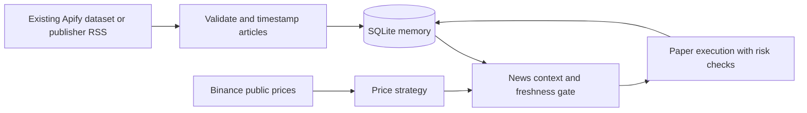

# Memory, news, decisions, and execution

The initial target is Binance spot, BTC/EUR, €300 of **paper money**, four-hour
candles. The new `agent-paper` workflow connects news intake, persistent memory,
and simulated execution. No real-money order adapter is implemented.



## What the memory remembers

`data/bot_memory.sqlite3` stores articles, publication time, **the first time
this bot received each article**, account balances, retained candle history,
strategy configuration, decisions, the articles available to each decision,
and paper fills. Restarting reuses this account. One SQLite transaction commits
account state, decision, and fills together; a failed write rolls them back.
Replaying a candle or starting another worker on the same account does not
duplicate its paper fills. Live-exchange order reconciliation is not provided.

This is durable, auditable memory, not an automatically trained model. The bot
does not rewrite its strategy after a loss or learn a profitable policy just
by collecting articles. News remains untrusted text, never executable commands
or instructions for order sizes.

## First news source

No Apify actor or dataset has been selected or run. Start with a public publisher
RSS feed; it needs no paid actor or API key. Cointelegraph's RSS URL below is
an example source, not a claim that its content predicts returns or that current
access has been verified. Supply another publisher feed with the same option.

```bash
cd /workspace/tradingbot
python3 -m tradingbot news --db data/bot_memory.sqlite3 sync \
  --rss-url https://cointelegraph.com/rss \
  --asset BTC --keyword bitcoin --keyword btc
```

Each retained article must have a title, HTTP(S) URL, and a timezone-aware
publication timestamp. RSS/Atom items without publication dates are omitted;
malformed JSON articles are counted as rejected. No dates are guessed.
Duplicate article URLs keep their original content and first-observed time.
Corrections under the same URL are not ingested as new events in this version.

Asset tags are supplied by the feed configuration. The optional keyword filter
is a simple title/text match; it is neither a relevance model nor sentiment
analysis. In the example, only articles mentioning `bitcoin` or `btc` are kept
and tagged BTC. Review the resulting data before treating that tag as reliable.

## Apify intake

The adapter can read an **existing** Apify dataset and keep it updated locally:

```bash
python3 -m tradingbot news --db data/bot_memory.sqlite3 sync \
  --apify-dataset YOUR_DATASET_ID --asset BTC \
  --keyword bitcoin --keyword btc --limit 100
```

Default dataset fields are `title`, `url`, `text`, `source`, and `publishedAt`.
Use repeated mappings for an actor's different flat schema, for example:

```bash
python3 -m tradingbot news --db data/bot_memory.sqlite3 sync \
  --apify-dataset YOUR_DATASET_ID --asset BTC \
  --field-map title=headline --field-map body=content \
  --field-map published=datePublished
```

Publication time must be timezone-aware ISO 8601 or integer Unix milliseconds.
An actor's own `observedAt` field is ignored: availability starts when **this
bot** receives the batch, not when the actor claims to have seen it. Importing
historical headlines today does not make them available to historical trades.

Public datasets may need no authentication. If your dataset requires an Apify
token, configure `APIFY_TOKEN` securely in environment settings with destination
`api.apify.com`; never paste its value into chat, command arguments, or source.
The adapter uses a bearer header, verified HTTPS, bounded response sizes, and
rejects redirects. `--token-env` selects another variable name, not a token.

**Reading a dataset does not start, schedule, or update an Apify actor.** A
separate actor schedule would need to produce current articles. Its output
schema, source quality, billing, and freshness must be checked before enabling
it. No actor fees have been incurred by this implementation. Latest-first
polling reads at most `--limit` records per refresh; bursts larger than that can
be missed. `--offset` supports manual backfill, not guaranteed complete capture.

You can also import a JSON export without network access:

```bash
python3 -m tradingbot news --db data/bot_memory.sqlite3 import \
  --file /path/to/articles.json --asset BTC
```

The file must contain an array such as
`[{"title":"...","url":"https://publisher.example/article","text":"...","publishedAt":"2026-11-07T12:00:00Z"}]`.
This is a schema example, not actual news. Import time is always the current
local receipt time; the command offers no backdating option.

## Run the integrated paper bot

```bash
python3 -m tradingbot agent-paper \
  --db data/bot_memory.sqlite3 --account binance-btceur-paper-v1 \
  --symbol BTC/EUR --timeframe 4h --cash 300 \
  --strategy donchian_breakout --news-policy require-fresh \
  --rss-url https://cointelegraph.com/rss \
  --keyword bitcoin --keyword btc
```

For an existing Apify news dataset, replace `--rss-url` with
`--apify-dataset YOUR_DATASET_ID`. The process reads news before market polling
at most once per 900 seconds by default; `--news-refresh` changes that interval.
This polling never launches an actor. Without either source option, the process
uses previously imported news only and tells you so at startup.

Two policies are available:

| Policy | What news changes |
| --- | --- |
| `observe` | Records recent available news with the price strategy's decision; preserves the price-only baseline. |
| `require-fresh` (default) | Additionally blocks a new long entry if no tagged article was both published and received within the last 24 hours. |

The gate does **not** decide whether a headline is bullish or bearish. Fresh
bad news still satisfies `require-fresh`. This policy is an operational test,
not a validated trading signal; compare separate experiments against `observe`
before claiming any benefit. Semantic event analysis and evidence that it
improves returns remain future research work.

The price strategy still chooses long/flat targets. News availability never
vetoes a strategy exit or the drawdown kill switch. News collection is
synchronous and may delay a poll by its timeout; the software kill switch
cannot cap losses while the process is stopped or network prices are
unavailable. Fees/slippage are assumptions; the default 0.10% fee per side
must be checked against the actual Binance account.

Use Ctrl+C to stop. Resume with the same command, database, and account ID.
Changed strategy, risk, costs, news policy, age limit, or configured feed/filter
settings are rejected. Use a new account ID for a separate experiment.
The memory database is shared: use a dedicated database for a controlled feed
experiment so unrelated manual imports do not change its context. Retained
price/news history grows over time; there is no automatic pruning or tuning.

Inspect the audit trail with:

```bash
python3 -m tradingbot memory --db data/bot_memory.sqlite3 \
  --account binance-btceur-paper-v1 --limit 20
```

The JSON includes account state, decisions, paper fills, and referenced articles
with both timestamps. The article lookup is capped at 1,000 referenced IDs per
inspection. Keep this database private and back it up using SQLite's backup
API or with all writers stopped; copying the database alone while WAL writes
are active can miss recent transactions.

## Current verification and remaining setup

Tests exercise the pipeline with labelled fixtures: intake, first-observed
time, stale-feed blocking, context-only decisions, transactional rollback,
restart/worker idempotency, and paper fills. They do not establish market alpha.

Live Binance, Apify API, and publisher-feed access are currently blocked by
the cloud proxy. The draft preserves the two Binance domain additions and adds
`api.apify.com`, `apify.com`, and `cointelegraph.com`. Review and save these in
environment settings before live validation; publish after validation to make
the prepared environment reusable. Redirects to other hosts may need an
additional, specifically diagnosed domain rule.

Run all tests with `python3 -m unittest discover -s tests`. The existing
[research workflow](RESEARCH.md) still evaluates price-only strategies; it does
not yet replay news policies. Real-data profitability and live news/exchange
integration remain unverified.
